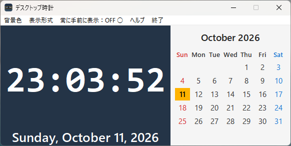

# DesktopClock（デスクトップ時計）

Windows向けのデスクトップ時計アプリです。

## 主な機能

- 時計と日付の表示
- 今月のカレンダー表示
- 背景色の変更
- 日付表示の切り替え（日本式・米国式）
- 12時間表示・24時間表示の切り替え
- 常に手前に表示
- ヘルプ機能

## ダウンロード

[**DesktopClock v1.0.0 をダウンロード**](https://github.com/fkanework-cell/DesktopClock/releases/latest)

リンク先の「Assets」にある `DesktopClock2.zip` をダウンロードしてください。

## 開発者

ケイン（KANE）

